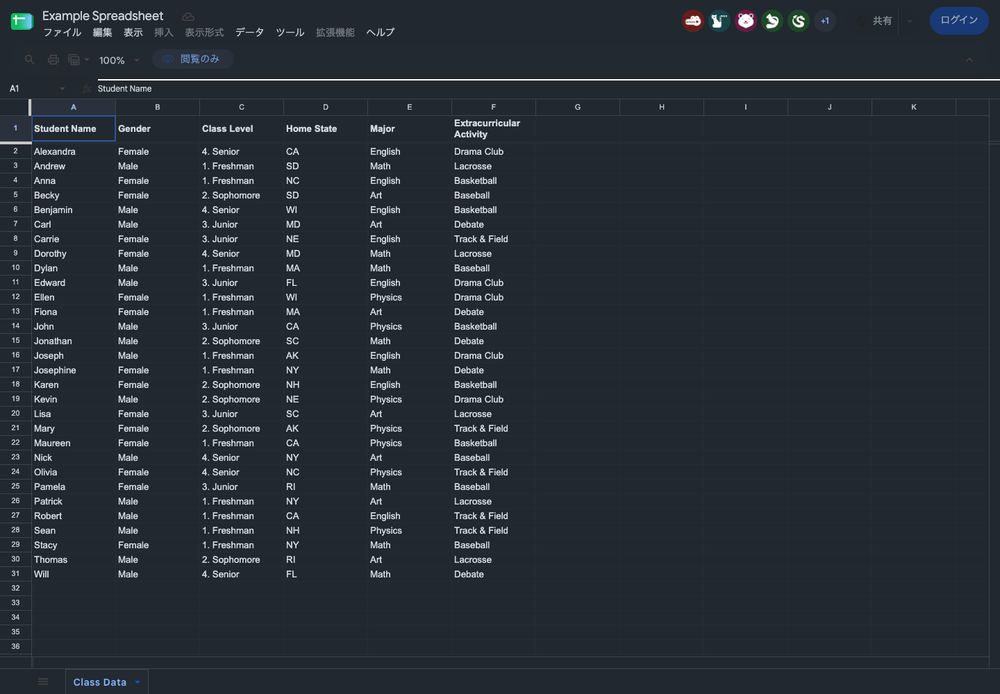
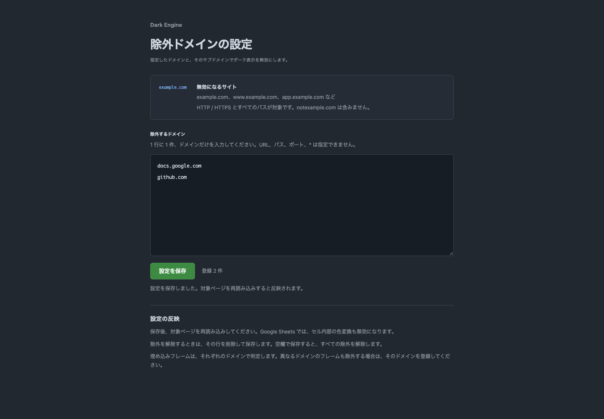

# Dark Engine

<div align="right">

[English](./README.md) | 日本語

</div>

ページの色を解析してダーク配色へ再マップする Chrome 拡張機能です。
Google Sheets のセル内部も暗くします。



## 機能

- 背景・文字・境界線を役割別に再マップし、ページ全体の `invert` フィルターを使わずに変換
- 写真・動画・画像の元の配色を保持
- 動的なコンテンツ、フォーム、疑似要素、SVG、open な Shadow DOM、フレームに追従
- グラデーション、影、半透明、OKLCH / Display P3 などブラウザが解釈できる色に対応
- Google Sheets の Canvas 2D で描かれたセル領域をダーク表示
- 全体の ON/OFF と、サブドメインを含むドメイン配下の除外

初期配色は GitHub の Dark dimmed を目安に、背景の基準色を `#212830`、
文字の基準色を `#d1d7e0` にしています。

## Google Sheets

Sheets のセルは Canvas で描かれるため、ページの CSS を変えるだけではセル内部が
明るいまま残ります。Dark Engine は描画時の背景・文字・罫線の色を再マップします。
保存されているセルの値や書式データは変更しません。

実サービスでのセル編集・数式入力・条件付き書式の変更は未確認です。

## 操作

初期状態ではダーク表示が有効です。拡張のポップアップから全体の ON/OFF を切り替えます。
設定は次のページ読み込みから反映されます。現在のページはポップアップの
『このページを再読み込み』で反映できます。Google Sheets では保存状態を確認してから
再読み込みしてください。

## ドメインの除外

ポップアップの『このドメイン配下で無効にする』で、現在のドメインとサブドメインを
除外できます。一覧を編集する場合は、ポップアップの『除外ドメインの設定を開く』、
または Chrome の拡張機能のオプションから設定画面を開きます。

`example.com` のように、1 行に 1 件のドメインを入力します。

| 入力              | 無効になる範囲                                      | 有効なままの範囲                   |
| ----------------- | --------------------------------------------------- | ---------------------------------- |
| `example.com`     | `example.com`、`www.example.com`、`app.example.com` | `notexample.com`                   |
| `app.example.com` | `app.example.com` とそのサブドメイン                | `example.com`、`other.example.com` |

HTTP / HTTPS、ポート、URL のパスにかかわらず同じ設定を使います。
入力できるのはドメインだけで、URL・パス・ポート・`*` は指定できません。
大文字・末尾のドット・重複は正規化し、日本語などの国際化ドメインは
ブラウザと同じ ASCII 表記で保存します。

保存後は対象ページを再読み込みしてください。除外ドメインでは通常の CSS 変換と
Sheets のセル内部の色変換を無効にします。解除する場合は該当行を削除し、
すべて解除する場合は空欄で保存します。

埋め込みフレームは自身のドメインで判定します。別ドメインのフレームも除外する場合は、
そのドメインを別途登録してください。オリジンを継承した `about:srcdoc` / `about:blank` は
継承元のドメインで判定します。



## インストール

Chrome 119 以上が対象です。Node.js と pnpm のバージョンは
[package.json](./package.json) に指定しています。

```sh
pnpm install --frozen-lockfile
pnpm build
```

1. `chrome://extensions` を開き、『デベロッパー モード』を有効にします。
2. 『パッケージ化されていない拡張機能を読み込む』で、このリポジトリの `dist/` を選択します。
3. ダーク表示にするページを再読み込みします。

再ビルド後は拡張機能と対象ページを再読み込みしてください。開発・テストのコマンドは
[package.json](./package.json) を参照してください。

## 制約

HTTP / HTTPS サイトを対象に動作を試みますが、あらゆる描画方式の完全変換は保証しません。

- Chrome 内部の画面、Chrome ウェブストア、ブラウザ内蔵 PDF ビューアー、`file://` は対象外
- closed な Shadow DOM、画像そのもの、一般サイトの Canvas / WebGL は変換対象外。暗いロゴは背景との区別が弱くなる場合あり
- Sheets の WebGL / OffscreenCanvas / 画像転送による描画、CanvasGradient / CanvasPattern は未対応。描画方式の変更時には追従が必要
- 作者の inline `!important`、CSS レイヤーの優先度、アニメーションやトランジションによって元の色が残ったり変換が遅れたりする場合あり
- コントラスト調整は単色背景が基準。画像・グラデーション・透明度・合成効果がある文字の読みやすさには制約あり
- 全 DOM の走査が残るため、大きいページや更新が頻繁なページでは処理負荷が発生。初回変換まで元の明るい表示が出る場合あり
- 配色の切り替え、サイト別の配色、明るさ調整、システム連動、ホワイトリストは未対応

## プライバシー

色の解析はブラウザ内で完結します。拡張自身のネットワーク通信、解析サービスへの
ページデータの送信、閲覧履歴の保存は行いません。`chrome.storage.local` に保存するのは、
全体の ON/OFF と除外ドメインだけです。

拡張の権限は `storage` のみです。HTTP / HTTPS ページへのスクリプト実行は
Manifest の `content_scripts` に宣言しています。
