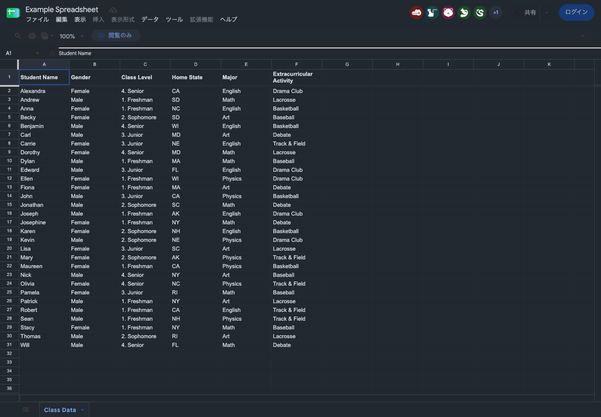
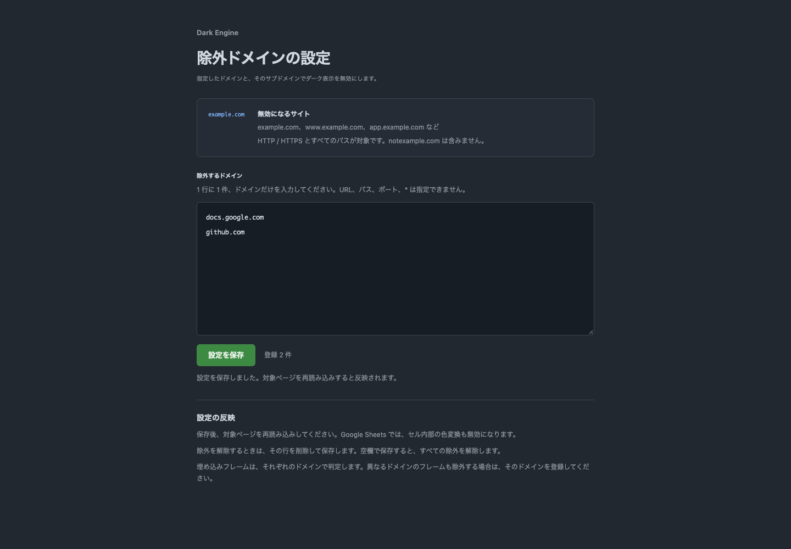

# Dark Engine

English | [日本語](./README.ja.md)

A Chrome extension that remaps page colors for dark mode, including Google Sheets
cells.

## Features

- Remaps backgrounds, text, and borders by role instead of applying a page-wide
  `invert` filter
- Keeps the original colors of photos, videos, and image assets
- Follows dynamic content, forms, pseudo-elements, SVG, open Shadow DOM, and frames
- Handles gradients, shadows, transparency, and browser-supported colors such as
  OKLCH and Display P3
- Darkens the Canvas 2D cell area in Google Sheets
- Provides a global on/off switch and domain exclusions that include subdomains

The default palette takes its cues from GitHub's Dark dimmed theme, with a base
background of `#212830` and base text color of `#d1d7e0`.

## Google Sheets

Sheets draws its cells on Canvas, so changing page CSS alone leaves the cell area
bright. Dark Engine remaps the cell backgrounds, text, and grid lines as they are
drawn. It does not change stored cell values or formatting.

Live editing, formula entry, and changes to conditional formatting have not been
verified.

## Controls

Dark mode is enabled by default. Use the extension popup to turn it on or off.
Settings take effect the next time a page loads; the popup can reload the current
page. Check that your work is saved before reloading Google Sheets.

## Exclude a domain

Use the popup to exclude the current domain and its subdomains. Open the exclusion
settings from the popup or Chrome's extension options to edit the list.

Enter one domain per line, such as `example.com`:

| Entry             | Excludes                                            | Leaves enabled                     |
| ----------------- | --------------------------------------------------- | ---------------------------------- |
| `example.com`     | `example.com`, `www.example.com`, `app.example.com` | `notexample.com`                   |
| `app.example.com` | `app.example.com` and its subdomains                | `example.com`, `other.example.com` |

The setting applies to HTTP and HTTPS, all ports, and all paths on the matching
domain. Enter domains only: URLs, paths, ports, and `*` are rejected. Uppercase,
trailing dots, and duplicates are normalized; internationalized domains are
stored using the browser's ASCII representation.

Save the list and reload the affected pages. An excluded domain skips both the
CSS engine and Sheets cell color conversion. Delete a line to remove an exclusion,
or save an empty list to clear all exclusions.

Embedded frames use their own domains. Register a different frame domain
separately if it should also be excluded. Origin-inheriting `about:srcdoc` and
`about:blank` frames use the inherited domain.

## Install

Requires Chrome 119 or later. Build from source and load `dist/` as an unpacked
extension; the steps are in [DEVELOPMENT.md](./DEVELOPMENT.md).

## Limitations

Dark Engine attempts to theme HTTP and HTTPS sites, but not every rendering method
can be converted completely.

- Chrome internal pages, the Chrome Web Store, the built-in PDF viewer, and
  `file://` pages are outside the supported scope
- Closed Shadow DOM, image contents, and Canvas / WebGL on general sites are not
  converted; dark logos may have low contrast against the new background
- Sheets WebGL, OffscreenCanvas, image-transfer rendering, CanvasGradient, and
  CanvasPattern are unsupported; changes to Sheets' rendering may require updates
- Author inline `!important`, CSS layer priorities, animations, and transitions
  can leave original colors in place or delay conversion
- Contrast adjustments assume solid backgrounds; text over images, gradients,
  transparency, or compositing effects may still be hard to read
- Full DOM scans remain, so large or frequently updated pages can be costly;
  original light colors may appear before the first conversion
- Palette selection, per-site palettes, brightness controls, system-theme sync,
  and allowlists are not provided

## Privacy

Color analysis runs locally in the browser. The extension makes no network
requests, sends no page data to an analysis service, and stores no browsing
history. It saves only the global on/off setting and excluded domains in
`chrome.storage.local`.

The sole extension permission is `storage`. Scripts run on HTTP and HTTPS pages
through the manifest's content-script declarations. See
[Permissions and data](./DEVELOPMENT.md#permissions-and-data) for the implementation
details.
