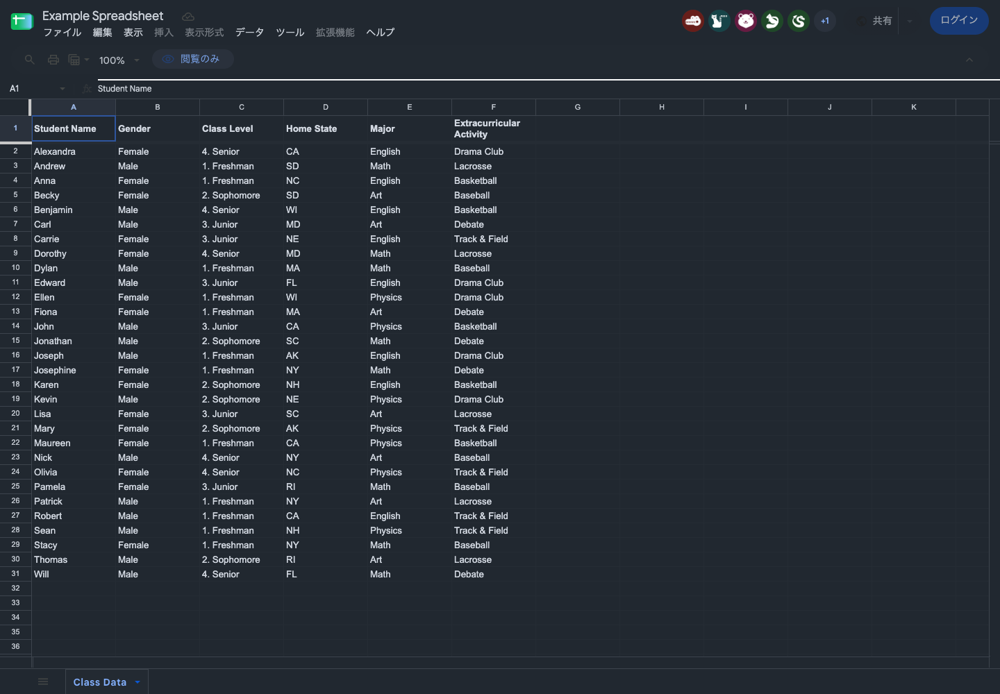
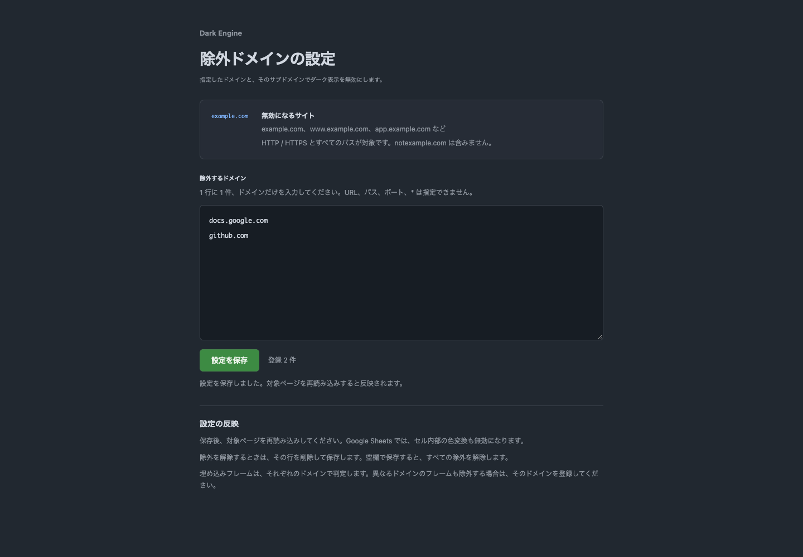

# Dark Engine

全 HTTP / HTTPS サイトを対象に、ページの色を解析してダーク配色へ再マップする、自作の Chrome 拡張機能です。ページ全体の `invert` フィルターや第三者製ダークモード拡張には依存しません。

初期配色は GitHub の Dark dimmed を目安に、背景を `#212830`、文字の基準色を `#d1d7e0` にしています。背景・文字・境界線を別々に変換し、有彩色は OKLab 色空間で明るさと彩度を調整します。写真・動画・画像 URL の中身は変換しません。



## インストール

開発には Node.js 24 系と pnpm 10.34.5 を使います。拡張の対象は Chrome 119 以上です。実際の動作確認は macOS / Chromium 158 で実施しています。

```sh
pnpm install --frozen-lockfile
pnpm build
```

1. Chrome で `chrome://extensions` を開く
2. 『デベロッパー モード』を有効にする
3. 『パッケージ化されていない拡張機能を読み込む』で、このリポジトリの `dist` を選ぶ
4. 対象のウェブページを再読み込みする

初期状態ではダーク表示が有効です。拡張のポップアップから全体の ON/OFF を保存できます。変更は各ページの次の読み込みから反映されます。現在のページは『このページを再読み込み』で反映してください。Google Sheets の編集中は、保存状態を確認してから再読み込みしてください。

初期実装では配色の切り替え、サイト別の配色調整、明るさ調整、システム連動、ホワイトリストは用意していません。画像で提示された配色は初期色の参考とし、厳密な一致は目指していません。

## ドメインの除外

ポップアップの『このドメイン配下で無効にする』で、現在のドメインを除外できます。『除外ドメインの設定を開く』から、除外一覧の追加・編集・削除もできます。Chrome の拡張機能の詳細画面から『拡張機能のオプション』を開く経路にも対応しています。

設定画面は 1 行に 1 件、`example.com` のようにドメインだけを入力して保存します。登録したドメイン自身と、そのサブドメインが除外されます。`example.com` は `www.example.com` や `app.example.com` を含み、`notexample.com` は含みません。`app.example.com` だけを登録した場合は、親の `example.com` や兄弟の `other.example.com` は対象外です。

HTTP / HTTPS、ポート、URL のパスにかかわらず同じドメイン設定を使います。入力欄には URL、パス、ポート、`*` を指定できません。大文字・末尾のドット・重複は正規化し、日本語ドメインはブラウザと同じ ASCII 表記で保存します。

保存後は対象ページを再読み込みしてください。除外したドメインでは通常の CSS 変換を起動せず、Google Sheets の Canvas 色変換も無効にします。除外を解除する場合は該当行を削除して保存します。空欄で保存するとすべての除外を解除します。

埋め込みフレームは自身のドメインで判定します。別ドメインのフレームも除外したい場合は、そのドメインを別途登録してください。オリジンを継承した `about:srcdoc` / `about:blank` は継承元のドメインで判定します。



## 対応範囲

- 通常の DOM、動的に追加・変更された要素、疑似要素、フォーム、SVG の塗りと線
- グラデーション、影、半透明の色、OKLCH / Display P3 を含むブラウザが解釈できる色
- 別オリジンの CSS、open な Shadow DOM、HTTP / HTTPS フレームとそれらを起点とする `about:srcdoc` などのフレーム
- Google Sheets のセル領域にある Canvas 2D の背景・文字・罫線

Google Sheets は CSS の変更だけではセル内部の描画を変えられないため、`docs.google.com/spreadsheets/*` に限定して、ページと同じ JavaScript world で Canvas の描画メソッドをラップします。色を変えるのは対象領域の描画時だけです。元の `fillStyle` / `strokeStyle` と `save()` / `restore()` の状態を保ち、セルの値や書式データを書き換えません。

公開の [Google Sheets サンプル](https://docs.google.com/spreadsheets/d/1BxiMVs0XRA5nFMdKvBdBZjgmUUqptlbs74OgvE2upms/edit) で、セルの背景ピクセル、文字、選択、スクロール後の再描画を確認しました。閲覧専用のため、実サービスでのセル編集・数式入力・条件付き書式の変更は未確認です。[検証記録](docs/verification/README.md) に、確認した URL、画像、未確認範囲をまとめています。

同じ配色の要素は、疑似要素の色も含めて CSS ルールを共有します。変換結果が前回と同じならシートの内容を置換しません。拡張のシート切り替えで新しく生じた色の CSS トランジションは打ち切って最終色を反映し、再解析の自己ループを防ぎます。サイト本来の色のトランジションが続いている間は、終了またはキャンセルを待ってから再解析します。透明度・位置など配色以外のトランジションは打ち切りの対象外です。

## 制約

全サイトを対象に動作を試みますが、あらゆる描画方式の完全変換は保証しません。

- `chrome://`、Chrome Web Store、ブラウザ内蔵 PDF ビューアーなど、拡張を注入できない画面は対象外。`file://` も初期実装の対象外
- closed な Shadow DOM、画像そのもの、一般サイトの Canvas / WebGL は変換しない。暗い単色の画像やロゴは見づらくなる場合がある
- Sheets の WebGL / OffscreenCanvas / 画像転送による描画、CanvasGradient / CanvasPattern は未対応。Sheets の DOM や描画方式が変わった場合は追従が必要
- 作者の inline `!important`、優先度の高い CSS レイヤー、CSS アニメーションやトランジションでは、元の色が優先されたり変換が遅れたりする場合がある
- コントラスト調整は単色の背景と文字を基準にする。画像・グラデーション上の文字、半透明の文字、重なりや合成効果については読みやすさを保証しない
- DOM をまとめて再走査するため、大きなページや更新が頻繁なアプリでは処理負荷と表示の追従に課題が残る。初回変換まで元の明るい表示が出る場合がある

## 開発と検証

```sh
pnpm dev                 # TypeScript / HTML / CSS / manifest の変更を監視
pnpm check               # strict 型検査、配色・ドメインの単体テスト、フォーマット確認
pnpm exec playwright install chromium
pnpm test:e2e            # dist の拡張を読み込む Chromium テスト
pnpm verify:sites        # 公開サイトを実際に開いて検証し、画像と結果を更新
```

開発時も変更後は `chrome://extensions` で拡張を更新し、対象ページを再読み込みしてください。`pnpm dev` は型検査を実行しないため、別途 `pnpm typecheck` で確認します。

[テストの目的と残す基準](docs/testing.md) に、各テストが保証すること、削除・置き換えた判定、不具合を入れたコピーでの検知結果をまとめています。

`pnpm test:e2e` は制御した検証ページを使い、実サービスへの書き込みやログインは行いません。Sheets 用のテストは URL をルーティングした検証用 HTML です。`pnpm verify:sites` はこれと別に、本物の公開 Sheets、GitHub、Wikipedia、Example Domain を開きます。いずれも一時プロファイルを使い、普段の Chrome のアカウントや設定には触れません。画面を表示して実行するときは `HEADED=1 pnpm test:e2e` または `HEADED=1 pnpm verify:sites` を使います。

DOM の再解析に入ってからの同期処理時間は、対象ページの DevTools コンソールから確認できます。再解析前のトランジションの完了待ちや、処理後の描画・操作全体の時間は含みません。負荷の評価には、メインスレッドのタスク時間や Long Task も併せて確認します。

```js
performance.getEntriesByName("dark-engine:render").at(-1)?.duration;
```

[負荷の調査記録](docs/performance/2026-11-08/README.md) と [改善前後の比較](docs/performance/2026-11-08-improvement/README.md) に、測定結果と未確認範囲をまとめています。

## 構成

```text
manifest.json             Chrome Manifest V3。全 HTTP / HTTPS サイトを対象に宣言
src/
  engine/
    color.ts              色空間変換、役割別の再マップ、コントラスト調整
    css-colors.ts         CSS 色の解釈と、複合 CSS 値の色変換
    dom-engine.ts         元の computed style の解析と動的更新の追従
    sheets-canvas.ts      Sheets の Canvas 2D 描画時の色変換
  entries/                ISOLATED / MAIN world ごとの起動処理
  popup/                  全体の ON/OFF、現在のドメインの除外、再読み込み
  options/                除外ドメイン一覧の設定画面
  settings/               設定の読み込み、ドメイン入力の正規化と照合
scripts/
  build.mjs               esbuild で独立した IIFE を生成
  verify-sites.mjs        公開サイトの読み取り専用検証
  profile-performance.mjs 一時プロファイルで負荷を比較する調査用スクリプト
tests/                    色変換テスト、拡張のブラウザテスト、検証用ページ
docs/verification/        実サイトの検証結果と画像
```

手元の `google-search-navigator-extension` と `github-foldable-view-extension` の TypeScript ベースの構成、Manifest の生成、実ページでの拡張テストを参考にしました。この拡張は独立した content script と MAIN world script が中心なので、UI フレームワークや拡張開発フレームワークを追加せず、TypeScript strict と esbuild の小さな構成にしています。ランタイムの外部パッケージ依存はありません。`dist/manifest.json` のバージョンは `package.json` から生成します。

## 権限とデータ

`storage` は全体の ON/OFF と除外ドメインの保存に使います。全サイトでの実行は Manifest の `content_scripts.matches` に宣言しています。`tabs`、`scripting`、Cookie、履歴への権限は要求しません。ポップアップは追加の権限を必要としない Tabs API で現在のタブ ID を取得し、そのタブの content script へメッセージを送ってホスト名を取得します。ページ全体の URL や本文は取得せず、再読み込みも Tabs API で実行します。

色の解析はブラウザ内で完結します。拡張自身はネットワーク通信、解析サービスへの送信、閲覧履歴の保存を行いません。MAIN world へ渡す状態は、有効・無効を表す DOM 属性だけです。

実装時に確認した公式資料: [Chrome の content scripts](https://developer.chrome.com/docs/extensions/reference/manifest/content-scripts)、[フレームの起点に基づく注入の対応バージョン](https://developer.chrome.com/docs/extensions/reference/api/scripting#property-RegisteredContentScript-matchOriginAsFallback)、[Playwright の拡張機能テスト](https://playwright.dev/docs/chrome-extensions)。
