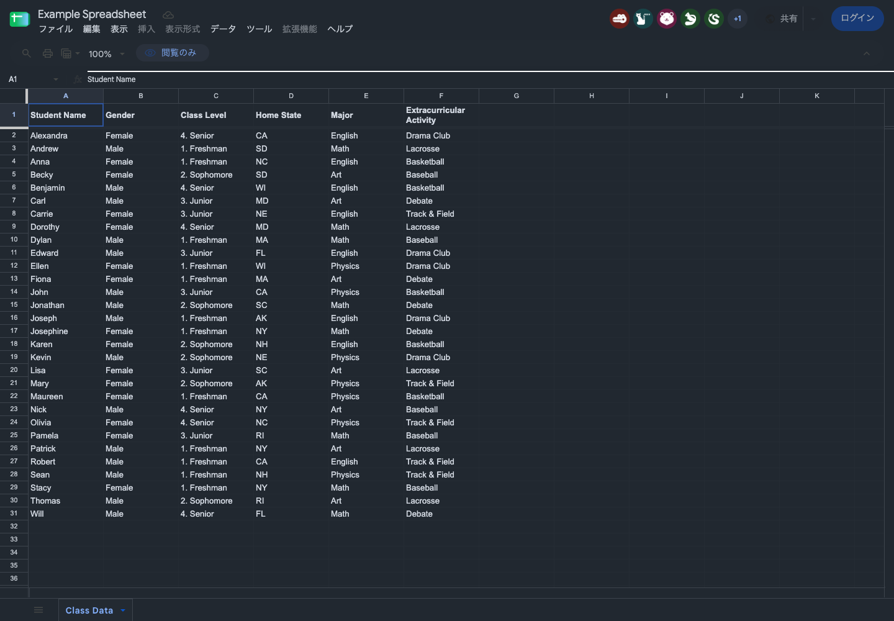

# 動作確認

2026-11-08 に macOS / Playwright 1.65.0 / Chromium 158.0.8127.18 で確認しました。ビルドした `dist` を一時プロファイルに読み込み、サイト本来のライト表示と拡張によるダーク表示を比較しています。普段の Chrome やログイン済みアカウントは使用していません。

## 実際の公開サイト

| 対象           | 直接開く URL                                                                                                    | 確認結果                                                                                             |
| -------------- | --------------------------------------------------------------------------------------------------------------- | ---------------------------------------------------------------------------------------------------- |
| Google Sheets  | [Example Spreadsheet](https://docs.google.com/spreadsheets/d/1BxiMVs0XRA5nFMdKvBdBZjgmUUqptlbs74OgvE2upms/edit) | Canvas 内部の白いセルを `#212830` に変換。文字、罫線、セル選択、矢印キー、スクロール後の再描画を確認 |
| GitHub         | [dark-engine-extension](https://github.com/kokoichi206/dark-engine-extension)                                   | リポジトリ画面の背景、文字、リンク、境界線を変換                                                     |
| Wikipedia      | [Color](https://en.wikipedia.org/wiki/Color)                                                                    | 記事、目次、フォームを変換。写真は元の配色を保持                                                     |
| Example Domain | [example.com](https://example.com/)                                                                             | ルート背景と文字、リンクを変換                                                                       |

初回は GitHub の接続が HTTP/2 エラーになったため、新しい一時ブラウザで再確認しました。再実行では全対象で HTTP 200、JavaScript の `pageerror` は 0 件でした。ルートと body の `filter` は変換前後とも `none` です。Sheets の Canvas 座標 `(100, 100)` の RGBA は、変換前が `[255, 255, 255, 255]`、変換後が `[33, 40, 48, 255]` でした。

Sheets の閲覧専用サンプルを使用しているため、実サービスでのセル編集・数式入力・条件付き書式の変更は未確認です。セル選択と矢印キーの操作後に名前ボックスの値が変わること、スクロール後に Canvas の描画内容が変わることをアサーションで確認しています。スクリーンショットでも暗い表示が続くことを確認しています。既存の公開シートの内容は変更していません。

[実測結果の JSON](results.json) に URL、色、Canvas のピクセル、ブラウザのバージョンを残しています。`renderDurationMs` は測定時点の直近 1 回の DOM 再走査時間であり、初回表示や操作全体のベンチマークではありません。今回の確認では Sheets が約 14 ms、GitHub が約 38 ms、Wikipedia が約 80 ms でした。この同期区間は改善前と計測範囲が異なるため、性能の比較には [改善前後のタスク時間](../performance/2026-11-08-improvement/README.md) を使います。大きいページの全走査には引き続き改善余地があります。

## 比較画像

| 対象           | 変換前                        | 変換後                                                                |
| -------------- | ----------------------------- | --------------------------------------------------------------------- |
| Sheets         | [ライト](sheets-light.png)    | [ダーク](sheets-dark.png) / [選択・スクロール後](sheets-scrolled.png) |
| GitHub         | [ライト](github-light.png)    | [ダーク](github-dark.png)                                             |
| Wikipedia      | [ライト](wikipedia-light.png) | [ダーク](wikipedia-dark.png)                                          |
| Example Domain | [ライト](example-light.png)   | [ダーク](example-dark.png)                                            |



画像を変換しない方針のため、Wikipedia の暗い単色ロゴなど、元画像によっては背景との区別が弱くなる部分が残ります。Sheets の数式バー下にも元の明るい境界線が残ります。すべてのサイトで完成した配色になったとは判断していません。

## 自動テスト

`pnpm check` は型検査、配色とドメインの単体テスト 32 件、フォーマット確認を実行します。`pnpm test:e2e` は配布用の拡張を Chromium に読み込む 15 件のブラウザテストです。

2026-11-06 のテスト見直しで、固定の変換値・文字列の一致、パーサーのモック、本番のコントラスト関数による自己採点を削除・置換しました。各テストが保証することと、意図的な不具合 11 種類を検知した結果は [テストの方針と検知確認](../testing.md) に記載しています。

Sheets 用ブラウザテストは制御した HTML で注入と描画互換性を確認します。実サービスの確認は `scripts/verify-sites.mjs` に分け、内部の DOM 属性の有無ではなく、実際の背景・本文のコントラストと Canvas の描画ピクセルから判定します。

## ドメイン除外の追加確認

2026-11-06 に macOS / Chromium 158 の一時プロファイルで、ポップアップからの追加と設定画面からの解除を確認しました。普段の Chrome の設定は変更していません。

- [GitHub のリポジトリ画面](https://github.com/kokoichi206/dark-engine-extension): ポップアップで `github.com` を除外し、再読み込み後に背景が白へ戻ることを確認。解除後は `#212830` へ復帰
- [公開の Google Sheets](https://docs.google.com/spreadsheets/d/1BxiMVs0XRA5nFMdKvBdBZjgmUUqptlbs74OgvE2upms/edit): 設定画面で `docs.google.com` を除外し、Canvas 座標 `(100, 100)` が `[255, 255, 255, 255]` になることを確認。解除・再読み込み後は `[33, 40, 48, 255]` へ復帰

[実測結果](domain-results.json)、[設定画面](options-domains.png)、[新しいポップアップ](popup.png)、[GitHub の除外時](github-excluded.png)、[Sheets の除外時](sheets-excluded.png) を保存しています。設定画面は幅 390 px でも横にはみ出さないことを確認しました。

追加したブラウザテストは、設定の保存・再表示、無効な入力による保存拒否、ドメイン自身とサブドメインの除外、別ドメインとの境界、オリジンを継承する srcdoc、ポップアップからの追加、設定画面の起動、解除後の復帰、Sheets 用スクリプトの無効化を確認します。これらは制御した検証ページでのテストです。

## 再確認

```sh
pnpm install --frozen-lockfile
pnpm exec playwright install chromium
pnpm check
pnpm test:e2e
pnpm verify:sites
```

制御した検証ページを手元で開く場合は `node tests/server.mjs` を実行し、[通常の検証ページ](http://127.0.0.1:4173/) または [CSP の検証ページ](http://127.0.0.1:4173/strict.html) を、拡張を読み込んだ Chrome で開きます。サーバー停止中はこれらの URL にアクセスできません。

GitHub Actions のワークフローも追加していますが、今回確認したのはローカル実行です。CI 上の実行結果はまだありません。
